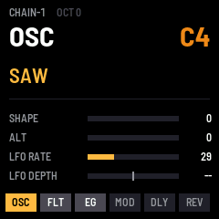
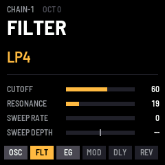
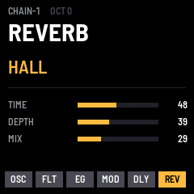
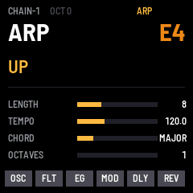

# CHAIN-1：照 NTS-1 mk1 訊號流程設計的 FM-1 自製韌體

單音合成器，固定一條訊號鏈：**OSC → FILTER → EG → MOD → DELAY → REVERB**，另外有琶音器。
各區段的「TYPE + A/B + 第二組參數」架構，參考 KORG NTS-1 mk1（調查見 `../NTS1_SYNTHESIS_CHAIN.md`）。
DSP 全部自己寫，沒有使用 Korg 的程式碼、音色或素材；本專案與 Korg、M-VAVE 無關。授權 MPL-2.0。

同一份原始碼編出：
- `dist/chain-1-0.1.fwsc`：燒進 M-VAVE FM-1 實機（安裝識別碼 `FM-1_94000100`）
- `dist/chain-1-0.1.rfm1`：在 RemoteFM1 裡跑（WebAssembly）
- `dist/chain-1-demo.mp3`：用 host 模擬器錄的 23 秒 demo（6 組出廠音色，包含琶音），聲音和實機是同一份 DSP

| | | | |
|---|---|---|---|
|  |  |  |  |

## 操作

| FM-1 控制 | 作用（括號是對應的 NTS-1 操作）|
|---|---|
| EDIT / LFO | OSC 頁（OSC）|
| SEL | FILTER 頁（FILTER）|
| ENV | EG 頁（EG）|
| FX | 每按一次依序切到 MOD → DELAY → REVERB（MOD / DELAY / REVERB）|
| ARP | 短按：琶音開 / 關並切到 ARP 頁；按住 0.5 秒：latch（ARP）|
| SELECT 編碼器 | 換區段 |
| PRESET 編碼器 | 這個區段的 TYPE（TYPE 旋鈕）|
| K1 / K2 | A / B（A / B 旋鈕）|
| K3 / K4 | 第二組參數（NTS-1 要按住區段按鈕再轉 A/B）|
| 按住 GLO 再轉 K1–K4 | 微調（每格 1 而不是 8）|
| ALGORITHM 編碼器 | 載入出廠音色：INIT、BASS、LEAD、PAD、ARP VPM、DRONE |
| OCT− / OCT+ | 八度 −2..+2 |
| SAVE | 把目前音色存進 flash（有未存的變更時燈會亮）|
| HOME | 全部音符關閉、清空效果殘響 |
| MASTER | 音量 |
| 鍵盤 | 單音、後按優先；同時從 USB-MIDI 送出 |
| MIDI in（USB / TRS）| 音符；CC 74 cutoff、71 resonance、73 attack、72 release |

畫面最下方那一排是整條訊號鏈：亮色是目前所在的區段，暗色是 OFF（bypass）的區段。

## 各區段

| 區段 | TYPE | K1 | K2 | K3 | K4 |
|---|---|---|---|---|---|
| OSC | SAW、TRI、SQR、VPM | SHAPE | ALT | LFO RATE（0–30 Hz）| LFO DEPTH（P = 音高 ← → S = shape）|
| FILTER | LP2、LP4、BP2、BP4、HP2、HP4、OFF | CUTOFF | RESONANCE | SWEEP RATE | SWEEP DEPTH（D 往下 ← → U 往上）|
| EG | ADSR、AHR、AR、AR LOOP、OPEN | ATTACK | RELEASE | TREM RATE（0–60 Hz）| TREM DEPTH |
| MOD | OFF、CHORUS、ENSEMBLE、PHASER、FLANGER | TIME | DEPTH | | |
| DELAY | OFF、STEREO、MONO、PING PONG、HI PASS、TAPE | TIME（10–500 ms）| DEPTH（feedback）| MIX | |
| REVERB | OFF、HALL、PLATE、SPACE、RISER、SUBMARINE | TIME（0.3–10 s）| DEPTH（阻尼）| MIX | |
| ARP | UP、DOWN、UP-DOWN、DOWN-UP、CONVERGE、DIVERGE、CONV-DIV、DIV-CONV、RANDOM、STOCHASTIC | LENGTH 1–24 | TEMPO 56–240 | CHORD（OCTAVE、MAJOR、SUS、AUG、MINOR、DIM）| OCTAVES 1–3 |

SHAPE / ALT 的意義（我自己定義的，NTS-1 原廠的定義沒有公開）：
- SAW：SHAPE = hard sync（1–4 倍頻率）；ALT = 低八度的 sub osc 音量
- TRI：SHAPE = wavefolder；ALT = sub osc
- SQR：SHAPE = 脈寬 50 → 95 %；ALT = sub osc
- VPM：SHAPE = 相位調變指數；ALT = 調變器頻率比（0.5、1、1.5、2、3、4、5、7）

## 程式結構

```
app/dsp.h, dsp.c   聲音引擎（o2 單元：-O2、-fno-builtin，在 FM-1 上從 RAM 執行）
app/app.c, app.h   面板、畫面、出廠音色、存檔、MIDI
app/fm1.toml       build 設定（o2 = ["dsp.c"]、識別碼 FM-1_94、不含藍牙）
app/tests/basic.txt   功能測試（28 項）
app/tests/types.txt   每種 TYPE 都彈一次，並檢查有聲音（36 項）
app/tests/demo.txt    錄 demo
```

- 執行緒模型：主迴圈擁有音色（`patch_t`），透過雙緩衝槽交給 audio interrupt；按鍵事件走一個 64 格的環形佇列；voice、琶音、效果都只在 audio interrupt 裡跑。
- 控制率：LFO、濾波器係數、效果增益每 16 個 sample 算一次。
- 記憶體（FM-1）：DSP 程式碼 15 KB 在 RAM（`.app_ram`）；delay 2 × 22,528 個 int16、reverb 4 × 3,700 + 4 × 640 個 float、mod 2 × 2,048 個 float，都放在 `.pool`（用掉 245 / 344 KB）。

## 編譯（2026-11-06 實測）

環境同 `../fm1-hello/README.md`：JieLi toolchain 20260730.1、AC79 SDK `d179b44`（sparse checkout）、emsdk 6.0.10、Python 3 + Pillow（含 raqm）。

```sh
./build.sh --host && app/build/host/chain-1_host app/tests/basic.txt app/build/host
./build.sh --release 0.1            # → app/build/chain-1-0.1.fwsc
./build.sh --rfm1 --release 0.1     # → app/build/chain-1-0.1.rfm1（先 commit）
node base/tests/rfm1_test.mjs app/build/chain-1-0.1.rfm1
```

### 實測結果
- **host 模擬器**：`basic.txt` 28 項全部 ok；`types.txt` 36 個音（包括共振和 feedback 開到最大）全部有聲音，沒有削波、沒有 NaN；host CPU 負載 1–2 %。
- **`.fwsc`**：app 111,432 B；RAM code 20,056 / 32,768 B（其中 app 的 DSP 15,092 B）；`.data+.bss` 25,788 / 98,304 B；pool 245,320 / 344,064 B。fm1-base 的檢查全部 ok：RAM code 不會呼叫 flash、沒有 64-bit 乘法 CPU bug、沒有 soft-double、暫存器存取規則。
- **`.rfm1`**：140,526 B，8 MiB。`rfm1_test.mjs` 全部 ok（和弦 RMS 0.035）；FM1VST 的 `rfm1_check.py` 也 ok。source_url = `…/Tmp@17d36c5…`。
- **尚未驗證**：FM-1 實機的燒錄與 CPU 負載（還沒有實機數據；我估計單音加三個效果，每個 sample 約 250 次浮點運算，在 360 MHz 上應該很輕鬆）、在 remotefm1.com 網頁上實際播放、fm1-emu 晶片模擬器。

### 移植時踩到的坑
- RAM 程式碼不能呼叫 flash 裡的任何東西，包括：
  - fastmath.h 被編譯器留成獨立函式的 helper → 引入時用 `#define inline inline __attribute__((always_inline))`
  - 結構複製和清零迴圈被換成 memcpy / memset → `o2_cflags = ["-fno-builtin"]`，結構改成逐 word 複製
  - 變數當除數的 `%` → 改成減法或比較後歸零
- 從 flash（app.c）呼叫 RAM 函式要用 `PLAT_FAR(fn)(...)`，直接呼叫會出現 linker 錯誤 "relocation truncated to fit"。
- app 不能自己用 `volatile` 指標轉型（fm1-base 規定只有 BSP 可以存取暫存器）。
- 畫布上限是 240×144，所以分上下兩塊、各 120 列畫。

## 安裝
- **RemoteFM1**：https://remotefm1.com/ →「Open a file…」→ `dist/chain-1-0.1.rfm1`
- **FM-1 實機**（風險自負；先備份，準備好救磚工具）：`python3 base/tools/fm1_install.py dist/chain-1-0.1.fwsc`
