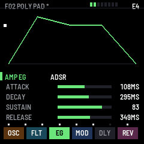
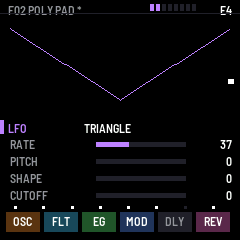
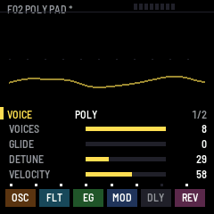
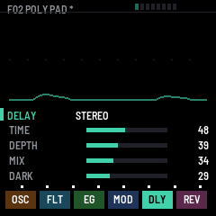
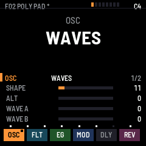
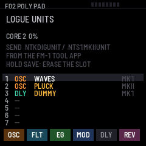

# CHAIN-1 1.0：照 NTS-1 訊號流程設計的 FM-1 自製韌體，能跑 NTS-1 的 logue 單元

最多 8 個聲部的合成器，訊號走一條固定的鏈：**OSC → FILTER → AMP → MOD → DELAY → REVERB**，另外有琶音器。

OSC、MOD、DELAY、REVERB 這四個位置，除了內建的類型，還能放 **NTS-1 的 logue SDK 單元**：
- NTS-1 mk1 的 `.ntkdigunit`
- NTS-1 mkII 的 `.nts1mkiiunit`

單元本身的 ARM 機器碼由 CHAIN-1 內建的直譯器在 FM-1 的第二顆核心上執行。

DSP、直譯器、介面全部自己寫；units 用到的 NTS-1 API 表格（查表、波表）取自 KORG 以 BSD-3 授權公開的 logue SDK。本專案與 Korg、M-VAVE 無關。授權 MPL-2.0（`app/logue/logue_rom.c` 的資料是 BSD-3，見 `LICENSES/logue-sdk.txt`）。

| | | | |
|---|---|---|---|
|  |  |  |  |
|  |  |  |  |

同一份原始碼編出：
- `dist/chain-1-1.0.fwsc`：燒進 FM-1 實機（識別碼 `FM-1_94010000`）
- `dist/chain-1-1.0.rfm1`：在 RemoteFM1 裡跑
- `dist/chain-1-demo.mp3`：host 模擬器錄的 demo，10 組出廠音色

## 1.0 新增（和 0.3 比）
- **複音**：POLY（最多 8 聲部）、MONO、LEGATO、UNISON（2–8 個聲部疊同一個音，帶 detune 和左右展開）。另外有 glide 和 pitch bend（範圍 0–12 半音）。
- **力度**：FM-1 鍵盤和 MIDI 的力度都吃。VELOCITY 旋鈕決定力度影響音量和濾波器包絡多少。
- **完整 ADSR**：
  - 音量包絡：A、D、S、R 各一顆旋鈕。類型有 ADSR、AR、AR LOOP、OPEN。
  - 獨立的濾波器包絡：ADSR、AD、LOOP。濾波器頁有 EG AMOUNT（正負）和 KEY TRACK。
- **LFO 頁**：6 種波形（三角、正弦、鋸齒、方波、S&H、DRIFT），可同時調變 PITCH、SHAPE、CUTOFF。MIDI CC1（mod wheel）會加顫音。
- **更多聲音**：
  - NOISE 振盪器（SHAPE 調顏色）
  - 每種振盪器都能混入噪音，TUNE ±24 半音
  - MOD 多了 TREMOLO 和 MIX
  - DELAY 多了 DARK（讓回音變暗）
  - 琶音器多了 GATE 和 SWING
- **16 組自己的音色**：ALGORITHM 旋鈕依序翻 10 組出廠音色（F01–F10）和存起來的 U01–U16。
- **介面**：
  - 每個區段有自己的顏色。
  - 上半部會依區段顯示：示波器、濾波器頻率響應曲線、ADSR 形狀（附目前位置的亮點）、LFO 波形、琶音步驟。
  - 標題列有 8 個聲部燈。
  - 參數多於 4 個的區段有分頁（右上角 1/2）。
  - 訊號鏈裡是 logue 單元的位置，會加一個小方塊標記。

## 操作

| FM-1 控制 | 作用 |
|---|---|
| EDIT | OSC 頁（再按：下一頁） |
| SEL | FILTER 頁，再按切到 FILTER EG |
| ENV | AMP EG 頁，再按切到 FILTER EG |
| LFO | LFO 頁 |
| SEQ | VOICE 頁（再按：第 2 頁 BEND） |
| FX | 依序切到 MOD → DELAY → REVERB |
| REC | 目前區段的下一頁（有分頁時 REC 燈會亮） |
| PLAY | UNITS 頁：看 FM-1 上的 7 個 logue 單元 |
| ARP | 短按：琶音開 / 關；按住 0.5 秒：latch |
| SELECT 編碼器 | 換區段 |
| PRESET 編碼器 | 這個區段的 TYPE。內建類型之後接著是 FM-1 上這個種類的 logue 單元 |
| K1–K4 | 這一頁的 4 個參數；按住 GLO 再轉是微調 |
| ALGORITHM 編碼器 | 換音色：F01–F10 出廠、U01–U16 自己存的 |
| SAVE | 短按：存進目前的 U 位置（如果現在是出廠音色，就存進第一個空位）。在 UNITS 頁按住 1 秒：刪掉游標所在的單元 |
| OCT− / OCT+ | 八度 −2..+2 |
| HOME | 全部音符關閉（GLO + HOME：USB host，可接 USB MIDI 鍵盤） |
| MIDI in | 音符與力度、pitch bend、CC1 mod wheel、CC74 cutoff、CC71 resonance、CC73 attack、CC72 release、CC123 all notes off |

## 各區段

| 區段 | TYPE | K1 | K2 | K3 | K4 |
|---|---|---|---|---|---|
| OSC | SAW、TRI、SQR、VPM、NOISE、＋logue 振盪器 | SHAPE | ALT | NOISE | TUNE ±24 半音 |
| FILTER | LP2、LP4、BP2、BP4、HP2、HP4、OFF | CUTOFF | RESONANCE | EG AMOUNT（±） | KEY TRACK |
| AMP EG | ADSR、AR、AR LOOP、OPEN | ATTACK 1 ms–10 s | DECAY | SUSTAIN | RELEASE |
| FILTER EG | ADSR、AD、LOOP | ATTACK | DECAY | SUSTAIN | RELEASE |
| LFO | TRIANGLE、SINE、SAW、SQUARE、S&H、DRIFT | RATE | PITCH | SHAPE | CUTOFF |
| VOICE | POLY、MONO、LEGATO、UNISON | VOICES 1–8 | GLIDE | DETUNE | VELOCITY |
| MOD | OFF、CHORUS、ENSEMBLE、PHASER、FLANGER、TREMOLO、＋logue | TIME | DEPTH | MIX | |
| DELAY | OFF、STEREO、MONO、PING PONG、HI PASS、TAPE、＋logue | TIME 10–500 ms | DEPTH（feedback） | MIX | DARK |
| REVERB | OFF、HALL、PLATE、SPACE、RISER、SUBMARINE、＋logue | TIME 0.3–10 s | DEPTH（阻尼） | MIX | |
| ARP | 10 種模式 | LENGTH 1–24 | TEMPO 56–240 | CHORD | OCTAVES 1–3；第 2 頁 GATE、SWING |

TYPE 是 logue 單元時，K1–K4 就是那個單元自己的參數，名稱和範圍照單元的定義，多的用 REC 翻頁。振盪器單元的前兩個參數一定是 SHAPE 和 ALT。

## logue 單元

### 怎麼裝
1. 下載 NTS-1 用的單元，例如網路上公開的 `.ntkdigunit` 或 `.nts1mkiiunit`，或自己用 logue SDK 編。
2. 用下面任一種方式傳到 FM-1，它會存進 7 個位置之一：
   - **Android**：FM-1 Tool 2.0（`android/fm1tool/dist/fm1tool-2.0.apk`）→「單元」分頁 → 選擇單元檔 → 傳送到 FM-1。
   - **電腦**：`python3 tools/fm1_units.py put 單元檔.ntkdigunit`。也可以 `list` 列出、`erase 3` 刪除。需要 mido 和 python-rtmidi。
3. 在 CHAIN-1 的對應區段轉 PRESET：內建類型之後就會出現這個單元的名字。
   - 振盪器單元在 OSC。
   - modfx 在 MOD，delfx 在 DELAY，revfx 在 REVERB。
4. 音色會記住用了哪個單元（用單元的 CRC 比對）。單元換了位置也找得回來；被刪掉的話，那個位置會改回內建，畫面提示「UNIT MISSING」。

### 運作方式
- **直譯器**（`app/logue/arm.c`）：執行 ARMv7E-M 指令集，也就是 Cortex-M4 / M7 的 Thumb-2、DSP 指令和 FPv4 單精度浮點。這正是 NTS-1 mk1（STM32F446）和 mkII（STM32H725，單元以 fpv4-sp-d16 編譯）的單元所用的機器碼。
- **安全**：每次記憶體存取都檢查範圍，單元只能碰自己的記憶體。下面任一種情況都只會停掉那個單元，不會讓 FM-1 當機：
  - 不認得的指令
  - 越界存取
  - 跑太久
- **載入**（`app/logue/logue.c`）：
  - mk1 單元放在它們原本的 SRAM 位址。
  - mkII 單元是 ELF 共享函式庫：做重定位，連到 NTS-1 的 API，跑 C++ 建構子，再呼叫 `unit_init`。
  - 表格和波表都放在 NTS-1 原本的位址（`logue_rom.c`，取自 logue SDK）。
  - `osc_white`、`osc_rand`、`fx_get_bpm`、`sdram_alloc` 等 API 函式，由韌體以原生程式碼實作。
- **執行**：單元在第二顆核心上跑。
  - 振盪器單元提前一個 block（5.8 ms）算好，交給聲部的濾波器和包絡。
  - 效果單元在場時，整條效果鏈改到第二核心處理上一個 block，會多 5.8 ms 延遲。
  - CPU 保護：第二核心連續 3 個 block 超過 85% 時，最重的那個單元會停掉，畫面顯示「TOO SLOW」。
- **取樣率**：NTS-1 是 48 kHz，FM-1 是 44.1 kHz。
  - 音高用的 midi→Hz 表已經依比例調整，所以音準正確。
  - 單元內部以「每秒」計算的東西（LFO、delay 時間、濾波器頻率）會慢或長約 9%。
  - tempo 同步的 delay 已經補償（`fx_get_bpm` 回報換算後的值）。

### 限制（請先看）
- **只在電腦上的模擬器驗證過**：
  - 直譯器和 qemu 的 Cortex-M4 逐位元組比對。
  - logue SDK 的範例單元能在 CHAIN-1 的 host 模擬器裡載入、發聲。
  - **還沒在 FM-1 實機上跑過**。
- **CPU**：直譯是有代價的。我估計 FM-1 的 CPU 每執行一個 ARM 指令要花十幾到二十幾個指令。SDK 範例的 waves 振盪器每個 sample 約 155 個 ARM 指令，估計會吃掉第二核心的一大半。
  - 簡單的振盪器或效果應該跑得動。
  - 很重的單元（例如移植 Mutable Instruments 的那類）大概會被 CPU 保護停掉。
  - 同時開好幾個單元，會更快碰到上限。
- **記憶體**：FM-1 沒有外接 SDRAM，每個位置可用的 RAM 是：
  - OSC 44 KB
  - MOD 32 KB
  - DELAY 92 KB
  - REVERB 88 KB
  - 每個位置還要扣掉單元本身和 8 KB 的堆疊與 I/O。NTS-1 的 delay、reverb 可以用到 2.4 MB SDRAM，要很長緩衝的單元載入時會顯示「NEEDS MORE RAM」。
- **振盪器單元只有一個聲部**（和 NTS-1 一樣），所以選了單元，VOICE 會變成單聲。
- **不支援**：
  - 參數的字串顯示（`unit_get_param_str_value`），一律顯示數字。
  - 單元自己的 preset。
  - mk1 的 modfx 只有 main 聲道（sub 給靜音）。
- **logue SDK 的 mkII `waves` 範例**：在這裡沒聲音，因為它的 `unit_init` 沒有呼叫振盪器的 `init()`（濾波器係數一直是 0）。這是範例本身的問題；mk1 版的 waves 和 mkII 的 pluck 都正常。

## 傳輸協定（給想自己寫工具的人）
沿用韌體更新的 SysEx 封包格式：`F0 pack7(00 59 cmd len24 body ~sum) F7`，實作在 `app/app.c` 的 `app_usb_cmd`。

| 指令 | 內容 | FM-1 回應 |
|---|---|---|
| `0x70` LIST | 無 | `0x78`：每個位置 23 bytes（是否使用、種類、mk1/mkII、名稱 20 字） |
| `0x71` PUT | 位置（`0xFF` = 自動）、長度 32-bit、CRC-32 | FM-1 像更新時一樣，用 `0x30` 讀取要求向主機要資料，每次 512 bytes。寫完回 `0x79`：狀態、位置 |
| `0x72` ERASE | 位置 | `0x79` |

單元的封裝格式是「LGU1」：256 bytes 的標頭加上程式碼，見 `app/logue/logue.h` 和 `tools/logue/logue_pack.py`。

## 程式結構
```
app/dsp.h, dsp.c          聲音引擎：8 聲部、包絡、LFO、效果、琶音、單元位置（o2，從 RAM 執行）
app/logue/arm.c, arm.h     ARMv7E-M（Thumb-2 + DSP + FPv4-SP）直譯器
app/logue/logue.c, .h      單元載入（mk1 / mkII）、NTS-1 API、呼叫
app/logue/logue_rom.c      NTS-1 API 的表格和波表（由 tools/logue/gen_rom.py 從 logue SDK 產生）
app/app.c, app.h           面板、畫面、出廠音色、16 組記憶、單元庫頁、USB 指令
app/tests/*.txt            host 模擬器測試；app/tests/units/ 是用 SDK 範例編的測試單元
tools/fm1_units.py         電腦端的單元工具（list / put / erase）
tools/logue/               logue_pack.py（打包）、gen_rom.py（產生表格）
tools/logue_test/          直譯器的對照測試（run.sh：和 qemu-arm -cpu cortex-m4 逐位元組比對）、build_units.sh
```

## 編譯與測試（2026-11-08）
```sh
./build.sh --host
for t in basic units types ui demo usbh; do app/build/host/chain-1_host app/tests/$t.txt app/build/host; done
./build.sh --release 1.0             # → app/build/chain-1-1.0.fwsc
./build.sh --rfm1 --release 1.0      # → app/build/chain-1-1.0.rfm1（先 commit）
tools/logue_test/run.sh              # 直譯器 vs qemu（需要 arm-none-eabi-gcc、qemu-user）
```
- **直譯器**：一個測試程式涵蓋整數、移位、旗標、DSP 指令、飽和運算、浮點、轉換、newlib 的 libm 與 libc、跳轉表、非對齊存取。它在 -O0、-O1、-O2、-Os、-O3 下各產生 93,584 個結果，和 qemu-arm -cpu cortex-m4 逐位元組相同。
- **host 模擬器**：basic、units、types、ui、demo、usbh 全部通過。types 會把每個區段的每個 TYPE 都彈過，確認有聲音。
- **`.fwsc`**（fm1-base 的檢查全部 ok）：
  - app 233 KB
  - RAM code 48 KB（直譯器約 18 KB）
  - SRAM 439 / 475 KB，還有 36 KB 空閒
- **尚未驗證**：FM-1 實機的燒錄、CPU 負載、logue 單元在實機上的速度。

## 安裝
- **FM-1 實機**（風險自負；先準備好原廠韌體和救援工具）：
  - Android：FM-1 Tool 2.0 →「安裝」。
  - 電腦：`python3 base/tools/fm1_install.py dist/chain-1-1.0.fwsc`
- **RemoteFM1**：https://remotefm1.com/ →「Open a file…」→ `dist/chain-1-1.0.rfm1`。logue 單元在 RemoteFM1 裡也能跑，但沒辦法把單元傳進去。
- 從 0.3 升級：設定格式改了，第一次開機會回到出廠音色。
