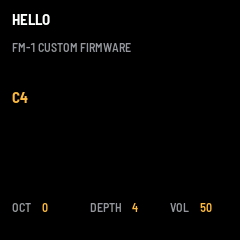

# HELLO：最基礎的 FM-1 自製韌體

同一份 C 原始碼，編出兩種產物：
- `dist/hello-0.1.fwsc`：燒進 M-VAVE FM-1 實機
- `dist/hello-0.1.rfm1`：在 RemoteFM1 裡跑（WebAssembly）

韌體建在 [fm1-base](https://github.com/charlesvestal/fm1-base) 上（`base/` submodule，釘在 `e07ebca`；felucca-bsp 在 `base/bsp/`，`78cf51b`）。授權 MPL-2.0。

## 功能

| 操作 | 作用 |
|---|---|
| 鍵盤 | 雙算子 FM 音色（後按的音優先），同時從 USB-MIDI 送出 note |
| MIDI in（USB / TRS）| 也能彈這個音色 |
| OCT− / OCT+ | 八度 −2..+2 |
| K1 | FM 深度 0..16（調變指數 = 深度 / 2）|
| SAVE | 把八度和深度存進 flash；有未存的變更時 SAVE 燈會亮 |
| MASTER | 音量 |



## 檔案

```
app/app.h        app 與平台的合約（名稱、audio block、存檔物件與 flash 位置、callback）
app/app.c        app 本身：音色、輸入、畫面、存檔
app/fm1.toml     build 設定：名稱、安裝識別碼 FM-1_93、USB 名稱、不含藍牙、manifest 資訊
app/words.tsv    螢幕閱讀器用的字詞
app/tests/basic.txt   host 模擬器測試腳本
build.sh         → python3 base/tools/build.py app "$@"
dist/            已編好的 0.1 版與 SHA256SUMS
```

## 編譯（2026-11-06 實測，Linux x86-64）

| 工具 | 版本 |
|---|---|
| JieLi toolchain | `jieli-linux-toolchains-20260730.1`（clang 4.0.1 for pi32v2），由 `base/tools/get_toolchain.sh` 下載 |
| AC79 SDK | tag `AC79NN_SDK_V1.2.1_2023-12-13` = commit `d179b44…`；只需要 3 個打包檔（sparse checkout 即可，SHA-256 與 build.py 內建的值相符）|
| Emscripten | emsdk 6.0.10（emsdk commit `a2b9277…`，與 fm1-base template 的 CI 相同）|
| Python | 3 + Pillow 12.3（含 raqm）|
| Node | 22（用來跑 `.rfm1` 測試）|

```sh
git submodule update --init --recursive
base/tools/get_toolchain.sh                  # → ~/.jieli/toolchain
export JIELI_TOOLCHAIN=~/.jieli/toolchain
# SDK：只抓打包需要的 3 個檔
git clone --depth 1 --filter=blob:none --sparse --branch AC79NN_SDK_V1.2.1_2023-12-13 \
    https://gitee.com/Jieli-Tech/fw-AC79_AIoT_SDK.git ~/fw-AC79_AIoT_SDK
git -C ~/fw-AC79_AIoT_SDK sparse-checkout set --no-cone \
    /cpu/wl82/tools/uboot.boot /cpu/wl82/tools/cfg_tool.bin /cpu/wl82/tools/cfg/eq_cfg_hw.bin
export AC79_SDK=~/fw-AC79_AIoT_SDK
source ~/emsdk/emsdk_env.sh                  # 給 --rfm1 / --web 用

./build.sh --host                            # host 模擬器
app/build/host/hello_host app/tests/basic.txt app/build/host     # 11 項檢查 + 截圖 + note.wav
./build.sh --release 0.1                     # → app/build/hello-0.1.fwsc（FM-1_93000100）
./build.sh --rfm1 --release 0.1              # → app/build/hello-0.1.rfm1（要先 commit，source_url 才對）
node base/tests/rfm1_test.mjs app/build/hello-0.1.rfm1          # 用 host app 的方式驅動 .rfm1
```

### 實測結果
- **host 模擬器**：`basic.txt` 11 項全部 ok（彈鍵 → note 60 + MIDI out、OCT+、K1、SAVE、重開機後設定還在、MIDI in）。
- **`.fwsc`**：app 81,160 B；RAM code 4,964 / 32,768 B；`.data+.bss` 24,932 / 98,304 B；pool 69,384 / 344,064 B；套件 614,938 B，識別碼 `FM-1_93000100`。編譯期檢查（RAM code、64-bit 乘法 CPU bug、soft-double、暫存器存取）全部 ok。
- **`.rfm1`**：101,249 B，8 MiB 記憶體。`base/tests/rfm1_test.mjs` 全部 ok（manifest、ABI 6 descriptor、畫面、和弦 RMS 0.048、14 顆按鈕、螢幕閱讀器、flash 存檔重開）；FM1VST 的 `tools/rfm1_check.py` 也 ok（28 個 export、4 份授權文字）。Manifest 的 `source_url` = `…/Tmp@a12f5ed…`。
- **尚未做**：還沒在 FM-1 實機上燒錄，也還沒在 remotefm1.com 的網頁上實際播放。

## 安裝 / 執行

**FM-1 實機**（風險自負：先備份，準備好救磚工具）：
```sh
pip3 install mido python-rtmidi
python3 base/tools/fm1_install.py dist/hello-0.1.fwsc
```
要回原廠韌體：用 M-VAVE 的工具或任一 Felucca 系安裝器的「回官方 V15」。

**RemoteFM1**：打開 https://remotefm1.com/，在韌體瀏覽器選「Open a file…」或把 `dist/hello-0.1.rfm1` 拖到頁面上。要用實體 FM-1 當面板的話，FM-1 需先燒 RemoteFM1（https://remotefm1.com/installer/），再選「Play on my FM-1」。iOS：用 RemoteFM1 App 開啟這個檔案。

## 已知問題
- 第一版畫面一次畫 240×240，但 fm1-base 的畫布上限是 240×144（`gfx.c` 的 `APP_CANVAS_PX`），所以下半部被裁掉了。現在改成分兩塊、各 120 列畫。
- `fm1.toml` 的 `screenshot` 路徑是相對於 `fm1-hello/`（`app/` 的上一層），不是 git repo 的根目錄。
- 有未 commit 的修改時，`--rfm1` 會警告 source_url 不準確；`firmware.json` 也由 build 產生，要一起 commit。
