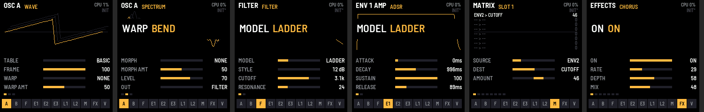

# PRISM-1 1.0：照 Vital 的架構，把 FM-1 用到滿的 wavetable 合成器

把 [Vital](https://github.com/mtytel/vital)（Matt Tytel，GPL-3.0）的聲音架構和互動方式，盡量完整地搬到 M-VAVE FM-1 的兩顆 360 MHz 核心上。Vital 的系統架構與互動整理在 [`docs/VITAL_REFERENCE.md`](docs/VITAL_REFERENCE.md)，每一項都對照了 PRISM-1 的做法。

同一份原始碼編出：
- `dist/prism-1-1.2.fwsc`：燒進 FM-1 實機
- `dist/prism-1-1.2.rfm1`：在 RemoteFM1 裡跑（WebAssembly）
- `dist/prism-1-demo.mp3`：24 個出廠音色各彈一段，用 host 模擬器錄的，和實機是同一份 DSP

授權 **GPL-3.0-only**（依循 Vital 的公式），詳見 `LICENSING.md`。本專案與 Vital Audio、M-VAVE 無關。



## 1.0 有什麼（相對 0.2）

| | 0.2 | 1.0 | Vital |
|---|---|---|---|
| Voices | 6，單核 | **8，兩顆核心各算一半**；unison 預算依 CPU 自動調整 | 1–32 |
| Wavetable 振盪器 | 2 | **3**，每個 unison 1–8，Vital 的 11 種堆疊、detune power、blend、stereo、frame spread、phase / random phase | 3，unison 1–16 |
| Wavetable | 6 張 × 8 幀 | **35 張 × 32 幀**，每幀 6 層 mip | 使用者自製 |
| Warp | 8 | **13**（sync、formant、quantize、bend、squeeze、pulse、FM / RM ← 另兩個振盪器或 sampler）| 13 |
| Spectral morph | 8 | **12**（Vital 全部）| 12 |
| Sampler 振盪器 | 噪音 | **17 種**：5 種即時噪音（白、粉紅、棕、黑膠、磁帶）+ 12 段存在快閃的合成取樣（呼吸、人聲 aah、拉弦、撥弦、玻璃、金屬、鼓…）| 載入音檔 |
| 去處 | 濾波器 / 直出 | **FILTER 1 / FILTER 2 / 兩個 / 只過效果 / 直出** | 相同 |
| 濾波器 | 1 個，4 種 | **2 個，串聯或並聯，Vital 的 8 種 model、全部 style**（analog、dirty、ladder、digital、diode、formant、comb、phaser）| 相同 |
| 包絡 | 3 | **6** DAHDSR，Vital 的時間律和 3 條 power 曲線 | 6 |
| LFO | 2 | **8**，9 種形狀 + **手繪 16 點**（每段有曲率），Vital 的 6 種 sync 模式，fade、delay、smooth、phase | 8 |
| 隨機 LFO | 無 | **4**：perlin、S&H、sine、lorenz | 4 |
| Macro | 無 | **4** | 4 |
| 調變矩陣 | 8 槽 | **32 槽**：amount、bipolar、power 曲線、bypass；幾乎所有連續參數（共 375 個參數）都能被調變，包括效果 | 64 |
| 效果 | 7 種固定順序 | **9 種、可重新排序**（chorus、OTT 式三頻段 compressor、delay 4 種、distortion 6 種 + 濾波器、3 段 EQ、filter、flanger、phaser、8 線 FDN reverb）| 9 |
| 音色 | 8 個出廠 | **24 個出廠 + 46 個使用者槽**（快閃），編輯中的音色斷電後保留 | |

## 架構

```
 keys / MIDI ─► 指令環 ─┐                     main loop：UI、wavetable 分步建表（每步 ≤ 2 ms）、存檔
                         ▼
 audio IRQ ─► core_render，每 32 frame 一個控制週期：
   每個 voice（偶數在 core 0，奇數在 core 1）：
     調變源（6 ENV、8 LFO、4 RANDOM、macro、velocity、pressure、note、wheel、bend、random）
     → 32 槽矩陣 → 所有被調變的參數
     → SMP、OSC 1–3（unison、warp；FM / RM 讀另一個振盪器這一塊或上一塊的輸出）
     → 各自的去處 → FILTER 1、FILTER 2（串 / 並；單聲道的 voice 只算一個聲道）
     → × (ENV 1 × 力度)²（Vital 的音量律）
   全部 voice 加總 → 9 個效果依 patch 的順序（參數被「最新的 voice」調變，同 Vital）→ 音量 → tanh
```

- `app/dsp/params.h`：375 個參數的表（名稱、種類、範圍、預設、能否被調變、per-voice 或全域）。矩陣、旋鈕的調變環、存檔都用這張表。
- `app/dsp/core.c`、`mod.inc`：voice、調變源、矩陣、路由、雙核心 render。
- `app/dsp/wt.c`、`osc.c`：35 張表的配方、12 種 morph、mip、振盪器、sampler。
- `app/dsp/filt.c`：8 種濾波器。`app/dsp/fx.c`：9 種效果。
- `app/presets.inc`：24 個出廠音色，用秒、Hz、半音寫成配方。
- `app/ui_*.inc`：頁面、格式、圖形、輸入、外框。
- `tools/gen_samples.py`：sampler 的 12 段取樣（合成產生，存成快閃常數）。

## 操作

| 按鈕 | 作用 |
|---|---|
| SEL | OSC 1 → OSC 2 → OSC 3 → SAMPLE（GLO：這一個開 / 關）|
| EDIT | FILTER 1 / FILTER 2（GLO：開 / 關）|
| ENV | ENV 1 … 6 |
| LFO | LFO 1 … 8（GLO：RANDOM 1 … 4）|
| SEQ | MATRIX |
| FX | EFFECTS（在效果頁再按：選中的效果開 / 關）|
| HOME | MACROS ↔ VOICE（GLO：USB host，接 USB MIDI 鍵盤）|
| **ARP** | **撿起這一頁的調變源**（ENV、LFO、RANDOM、MACRO），之後轉**任何**一顆旋鈕就是在設定這個來源對它的調變量；再按一次放下 |
| PLAY | hold（sustain）|
| REC | 全部音符關閉（GLO + 按住 1 秒：INIT 新音色）|
| SAVE | 存：使用者音色存回原槽；出廠音色存到下一個空槽（GLO：一定存成新的；按住：說明）|
| OCT− / OCT+ | 八度（GLO：上一頁 / 下一頁）|
| SELECT 編碼器 | 這一頁的主選項：wavetable、取樣、濾波器 model、LFO 形狀、隨機樣式、矩陣槽、效果（在效果頁按住 GLO：把效果在鏈中前後移動）|
| ALGORITHM 編碼器 | 這一頁的第幾列（標題列的小點）|
| PRESET 編碼器 | 出廠音色，接著是使用者音色（有未存的修改時，第一下只會提醒）|
| K1–K4 | 這一列的四個參數（GLO：微調；快轉會加速）|
| 鍵盤 | 力度和壓力（壓力是矩陣的 PRESSURE 來源）|
| MIDI in | 音符、CC1 mod wheel、CC64 sustain、channel pressure、pitch bend、CC74 / CC71 = FILTER 1 cutoff / resonance |

## 接 USB MIDI 鍵盤（USB host）

**GLO + HOME**：把 FM-1 的 USB-C 切成 **host**，接上 USB MIDI 鍵盤或控制器就能直接彈；再按一次，USB 就交還給電腦。開機時一定是一般的裝置模式。

- **要外接電源**：FM-1 不從 USB-C 供 5V 電。要用以下其中一種：
  - 有外接電源的 USB hub：FM-1 接 hub 的上游，鍵盤插下游。
  - 可另外插充電器的 OTG 轉接頭。
- **支援的裝置**：class-compliant 的 USB MIDI 1.0（full speed）鍵盤或控制器，可以直接接，或經過一個 hub。不支援低速裝置、多層 hub、MIDI 2.0 和 SysEx。
- **畫面**：
  - 提示列會顯示：等待中、鍵盤自己的名稱加「CONNECTED」、「NOT MIDI」，或「UNPLUGGED」。
  - 標題列右上角（取代 voice 小方塊）出現 USB 標示：暗色是等待中，亮色是已連上。
- **能彈什麼**：鍵盤送來的音符、力度、滾輪、pitch bend、sustain 等，跟原本的 MIDI 輸入一樣處理。
- **拔掉時**：自動放開所有音，不會卡音。
- **當 host 的期間**：沒有電腦連線，USB 音訊、韌體更新、螢幕鏡像都暫停。
- **底層**：felucca-bsp 的 USB MIDI host，從 Melodee 韌體移植，`fm1.toml` 的 `usb_host = true`。
- **測試狀態**：
  - 只在 host 模擬器上測過插上、彈奏、拔掉，測試檔是 `app/tests/usbh.txt`。
  - 這份移植版本身，文件寫明還沒有實機驗證。
  - 能不能認到 hub，也取決於 FM-1 的 USB-C CC 接法和你用的轉接頭。

### 畫面（Vital 的樣子：深藍灰底、青綠是數值、紫色是調變）
- **旋鈕**：青綠色弧是數值；外圈紫色弧是調變的可及範圍；白色刻度是最新 voice 正在聽到的值。撿起來源時，可被調變的旋鈕標籤變紫，數值改顯示調變量。
- **OSC**：32 幀的 3D 堆疊（每隔一幀畫一條），正在播的那幀用青綠色畫在它實際的（被調變後的）位置，而且已經套用 warp；右下是 unison 的展開。按住 GLO 改看這一幀的頻譜。
- **FILTER**：頻率響應曲線、cutoff / resonance 的點、cutoff 的調變範圍（紫）和 voice 正在用的曲線（白）；formant 有母音平面；右上角顯示哪些振盪器送進來、串聯或並聯。
- **ENV / LFO**：曲線加上最新 voice 的位置點；LFO 的 DRAW 列逐點改高度、曲率，或把目前的形狀轉成可畫的點。
- **RANDOM**：最近的軌跡。**MATRIX**：每頁 7 槽，來源、目的地、amount 條、來源的即時值。**MACROS**：四個大旋鈕和它們的目的地。
- **EFFECTS**：9 格的效果鏈（亮的是開著的），下方是選中效果的圖：EQ / FILTER 的響應、compressor 三頻段的電平與增益、delay 的回聲、distortion 的轉移曲線、reverb 的衰減、chorus / flanger / phaser 的掃動。
- **VOICE**：8 個 voice 的音高、CPU、目前的 unison 預算。

## 把 FM-1 用到滿：先堆、再減

第一次實機編譯時 SRAM 超出 **162 KB**。按「聽起來損失最小」的順序做減法：

| 減法 | 省下 | 代價 |
|---|---|---|
| delay 的線 2 × 32768 → 2 × 16384 | 64 KB | 最長延遲 1.49 s → 0.74 s（超過 0.37 s 自動半取樣率）|
| reverb 的線 32768 → 16384 | 32 KB | 最大房間 0.7 → 0.3 倍 Vital 的線長，pre-delay 最長 136 ms；decay 仍可到 64 s |
| 濾波器 comb 延遲線 1024 → 512 | 32 KB | comb 最低音高 43 Hz → 86 Hz |
| sampler 素材從 RAM 搬到快閃（編譯時產生）| 28 KB | 無（反而從 5 段增加到 12 段）|
| 全域調變改稀疏、即時值改 uint16、隨機軌跡改 uint8 | 2.2 KB | 無 |
| 設定檔借用存檔的 sector 緩衝 | 1.3 KB | 無 |
| 主 / 中斷堆疊照靜態分析定為 6400 / 4352 B | — | 最壞 4960 / 3108 B，留有邊際 |

一度把 wavetable 減到 24 幀；sampler 搬去快閃後，省下的 RAM 又把它加回 32 幀。

最後的用量（`./build.sh --release 1.2`）：

| | 用量 | 上限 |
|---|---|---|
| 快閃映像 | 526 KB（其中取樣 288 KB）| 581.5 KB |
| SRAM | 488.3 KB：RAM 程式碼 67 KB、.data+.bss 65 KB、pool 356 KB（4 張 wavetable 緩衝 129 KB、16 個濾波器 69 KB、效果 104 KB…）| 496.6 KB（剩 8.3 KB，build 規定至少 8 KB）|
| 快閃資料區 XDATA1 | 46 個使用者音色 | 全部 |

## 運算吃緊時、第二顆核心不能用時

- **自動減量**：render 來不及（超過時間的 90%）時，立刻停掉一個 voice（先停已經放開的，再停最舊的），並縮小 unison 預算。之後要連續 2 秒負載都低於 60%，才每秒放寬一點。所以吃緊時只會少幾個同時發聲的音，不會斷音或爆音。
- **第二顆核心**：有些 FM-1 的第二核心在高負載時會讀錯共用 RAM（felucca-bsp `chip/fm1_cpu1.h`，社群在多台機器上回報過）。這個韌體開了 `cpu2_fallback`，碰到這種情況，平台會停用第二核心，由第一核心獨自做完全部工作，直到關機。
  - 聲音不變，只是能同時發聲的數量大約減半，上面的自動減量會處理。
  - 發生時（或開機時本來就已經停用）提示列會顯示「ONE CORE」和原因：讀錯、太慢、當掉、沒回應、開機前已停用。VOICE 頁會常駐顯示「CORES 2」或「CORES 1」加原因。
- 測試：`app/tests/stress.txt` 在模擬器裡模擬過載和第二核心停用。

## 審視後的改進

- **濾波器的 CPU**：Vital 的濾波器拓撲每個樣本比預算重 2–4 倍。所以沒有立體聲展開、pan 置中、也沒有調變去動 pan 的音色，濾波器只算一個聲道再複製，成本減半；bass、lead、pluck 大多是這類。
- **Unison 預算**：每個新音都會算它要幾個振盪器聲部；超出預算就偷最舊的 voice。render 晚了（`APP_OVERLOAD`）預算縮小；CPU 低於 60% 時每秒慢慢放寬。所以 SUPERSAW 這種 7+3 聲的音色不會讓機器卡住，只是同時發聲數變少。
- **FM 的來源取音量之前的訊號**：跟 Vital 一樣，把調變用的振盪器音量關到 0，它仍然會去 FM 別的振盪器（FM BELL 就是這樣做的）。
- **音色響度一致**：逐一量每個出廠音色一段樂句的 RMS，再補償音量，RMS 落在 0.014–0.034。
- **不會誤丟編輯**：有未存的修改時轉 PRESET，第一下只提醒。
- **矩陣的目的地顯示區段**：例如「F1 CUTOFF」、「O2 FRAME」。

## 編譯與測試（2026-11-07）

環境同 `../fm1-hello/README.md`。

```sh
./build.sh --host
app/build/host/prism-1_host app/tests/basic.txt app/build/host    # 冒煙測試
app/build/host/prism-1_host app/tests/sounds.txt app/build/host   # 24 個音色，錄成 sounds.wav
app/build/host/prism-1_host app/tests/stress.txt app/build/host   # 最壞情況
./build.sh --release 1.2 && ./build.sh --rfm1 --release 1.2
node base/tests/rfm1_test.mjs app/build/prism-1-1.2.rfm1
```

`basic.txt` 涵蓋：
- 和弦、偷 voice（第 9 個音）
- 每一頁的截圖
- 撿起 LFO 1 指派給 cutoff
- 效果開關與重排
- 存進使用者槽後重開機還在

DSP 的各部分另外在桌機的 harness 上測過：
- **wavetable**：每張表都建得出來；mip 層級沒有超過上限的泛音；morph 和 warp 量為 0 時與不套逐位元相同；unison 1–8 聲音量都在單聲的 ±3% 內。
- **濾波器**：每種 model × style 在快速調變下都穩定，沒有 zipper；響應與實測相符。
- **效果**：參數極端值都穩定，各效果都產出了 demo。

### 已知限制
- spectral morph 是整張表一起套用（主迴圈分步重建），**不能**被 voice 調變；Vital 是每個 voice 用 FFT 即時算。
- 沒有 oversampling；高音區的 wavetable 有線性內插的鏡像（C7 約 −28 dB）。
- 濾波器和效果的拓撲照 Vital 縮小，個別有差異：dirty 的 cutoff 上限 14 kHz、ladder 只在輸入飽和、reverb 8 條線。
- CPU 用量是依指令數估算的，**還沒有實機數據**；音色只在模擬器上聽過。
