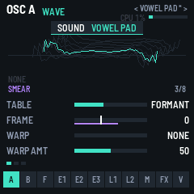
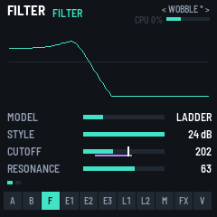
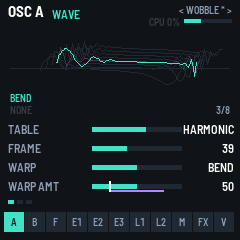
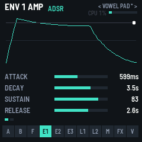
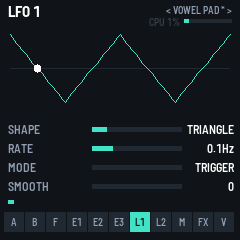
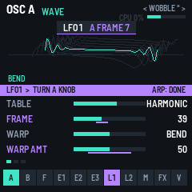

# PRISM-1：照 Vital 架構縮小的 FM-1 wavetable 合成器

把 [Vital](https://github.com/mtytel/vital)（Matt Tytel，GPL-3.0）的 voice 架構縮小到 M-VAVE FM-1 的一顆 360 MHz 核心上。
同一份原始碼編出：
- `dist/prism-1-0.2.fwsc`：燒進 FM-1 實機（安裝識別碼 `FM-1_95000200`）
- `dist/prism-1-0.2.rfm1`：在 RemoteFM1 裡跑（WebAssembly）
- `dist/prism-1-demo.mp3`：8 組出廠音色的試聽，用 host 模擬器錄的，和實機是同一份 DSP

授權 **GPL-3.0-only**（因為依循 Vital 的公式），詳見 `LICENSING.md`。本專案與 Vital Audio、M-VAVE 無關。


## 0.2：Vital 風格的 UI/UX

| | | |
|---|---|---|
|  |  |  |
|  |  |  |

Vital 的介面有四個招牌，0.2 都搬了過來：

1. **調變環**：
   - Vital 的每顆旋鈕外圈有紫色的弧，表示被調變的範圍。PRISM-1 的參數條下面多了一條紫線，表示調變矩陣能把它推多遠，也就是所有指向這個目的地的槽 |amount| 的總和，換算成這條參數條的單位。
   - 只要有 voice 在發聲，就會有一根白色指標顯示最新 voice 現在的實際值。這個值由引擎的 `SVIEW` 即時提供，每個 render 都更新。
   - 所以 LFO 調 cutoff 時，可以看到白色指標在紫色範圍裡來回跑。
2. **拖放指派調變**：
   - Vital 是把 ENV / LFO 拖到旋鈕上。FM-1 沒有觸控，所以改成：在 ENV1–3 或 LFO1–2 頁按 ARP，就「撿起」這個來源。
   - 撿起後，ARP 燈會閃，畫面底部出現紫色橫幅「LFO1 > TURN A KNOB」，可以被調變的參數標籤變成紫色，來源的頁籤也變紫色。
   - 接著到任何一頁轉任何一顆可調變的旋鈕：會自動找到或建立一個「LFO1 → 該參數」的調變槽，旋鈕調的是調變量而不是參數本身，提示會顯示「LFO1  CUTOFF +24」。
   - 再按一次 ARP 放下，或 10 秒沒動作會自動放下。不是來源頁時，ARP 還是跳到 MATRIX 頁。
3. **Wavetable 堆疊視圖**：
   - 8 幀從後往前斜著疊起來，靠近播放位置的那幀稍微亮一點。
   - 播放中的波形用青綠色畫在它實際的（被調變後的）幀位置上，已經套用了目前的 warp，畫的就是 voice 實際聽到的相位扭曲。warp 的公式和引擎相同，只是 FM / RM 需要另一個振盪器，所以不畫。
   - 左下角顯示 warp 名稱（青綠）和 spectral morph 名稱（紫），右下角顯示「幀 x/8」。
4. **即時游標和 Vital 的外觀**：
   - 包絡頁：最新 voice 的電平是一條線和一個點。LFO 頁：一個點跟著相位跑。
   - 配色是深藍灰底、青綠表示數值、紫色表示調變（在 app.c 裡重新定義了 gfx.c 的配色巨集）。
   - 標題列是 Vital 式的「< 預設名 >」（未存時加 `*`），還有 CPU 和輸出電平表。
   - 有 voice 在發聲時，上半部約 12 fps、下半部約 8 fps，所以白色指標會動。

## Vital 與 PRISM-1 的對照

| | Vital | PRISM-1 | 原因 |
|---|---|---|---|
| 複音 | 1–32（預設 8）| 1–6 | CPU |
| 振盪器 | 3 個 wavetable + 1 個 sampler | 2 個 wavetable + noise | CPU |
| Wavetable | 每幀 2048 sample、257 幀；每個 voice 每個 block（≤128 sample）都由頻譜做 IFFT 重建 | 每幀 256 sample、8 幀、6 層 mip（256→8 sample）；頻譜在主迴圈轉成時域表 | RAM 和 CPU |
| 內建表 | 使用者自製 / 匯入 | 6 組：BASIC（sine→tri→square→saw）、PULSE、FORMANT（母音 A E I O U）、HARMONIC、ORGAN（拉桿）、DIGITAL | |
| Spectral morph | 11 種，每個 voice 都可調變 | 8 種（LOW PASS、HIGH PASS、FORMANT、STRETCH、SMEAR、RANDOM、DISPERSE、SHEPARD），整張表一次算，**不能**被 voice 調變 | 每個 voice 都做 IFFT 太貴 |
| Phase warp（Vital 叫 distortion）| SYNC、FORMANT、QUANTIZE、BEND、SQUEEZE、PULSE、FM/RM ← A/B/sample | 前 6 種照 Vital 公式；FM/RM 是 A↔B（B 用 A 當下的 sample，A 用 B 上一個 sample）| |
| Unison | 1–16，多種 stack style | 1–3，對稱 detune、立體聲 spread | CPU |
| 濾波器 | 2 個（串聯 / 並聯），8 種 model | 1 個：ANALOG（SVF + tanh drive）、LADDER（4 極、回授 tanh）、FORMANT（3 個 band，AOIE / AIUO）、COMB（正 / 負回授）；12 / 24 dB；Vital 的 BLEND（low → band → high）| CPU |
| 包絡 | 6 個 DAHDSR，power 曲線 | 3 個 DAHDSR，用 Vital 的 `powerScale` 曲線和四次方時間（v⁴ 秒）；ENV1 = 音量 | |
| 音量律 | (ENV1 × lerp(1, vel, veltrack))² | 相同 | |
| LFO | 8 個，可畫形狀，6 種 sync 模式 | 2 個：7 種形狀（含 S&H、SMOOTH random）、TRIGGER / FREE / ENVELOPE；Vital 的 smooth（半衰期一階平滑）| |
| 調變 | 64 槽，含 power、bipolar、stereo、remap | 8 槽：來源 11 種 × 目的 17 種，amount ±100 | |
| 效果 | 9 種、可重新排序 | 7 種，照 Vital 的預設順序：CHORUS → COMPRESSOR（單頻段、上下壓縮）→ DELAY → DISTORTION（Vital 的 6 種）→ FLANGER → PHASER → REVERB（4 線 FDN）| RAM |
| Oversampling | 2× | 無 | CPU |

## 操作

| FM-1 控制 | 作用 |
|---|---|
| SELECT 編碼器 | 換頁：A、B、F（濾波器）、E1、E2、E3、L1、L2、M（矩陣）、FX、V（voice）|
| ALGORITHM 編碼器 | 這一頁的第幾列（畫面左下角的小點）|
| K1–K4 | 這一列的 4 個參數（按住 GLO 微調）|
| PRESET 編碼器 | 出廠音色：INIT、SUPERSAW、WARP BASS、VOWEL PAD、FM BELL、PLUCK、WOBBLE、ORGAN |
| SEL | OSC A ↔ OSC B |
| EDIT | FILTER |
| ENV | ENV1 → ENV2 → ENV3 |
| LFO | LFO1 ↔ LFO2 |
| ARP | MATRIX |
| FX | EFFECTS（再按一次換下一個效果）|
| HOME | VOICE（複音數、glide、velocity tracking、音量）|
| SAVE | 存目前的音色；有未存的變更時燈會亮，畫面上音色名稱旁會出現 `*` |
| REC | 全部音符關閉 |
| OCT− / OCT+ | 八度 |
| 鍵盤 | 有力度（`APP_TOUCH`），按壓力道 = 矩陣裡的 PRESSURE 來源 |
| MIDI in | 音符、CC1 → MOD WHEEL、channel pressure、pitch bend ±2、CC74 cutoff、CC71 resonance |

### 每一頁的參數
- **OSC A / B**：
  - WAVE 列：TABLE、FRAME、WARP、WARP AMT
  - SPECTRUM 列：MORPH、MORPH AMT、LEVEL、OUT（FILTER / DIRECT）
  - UNISON 列：VOICES、DETUNE、SPREAD、TRANSPOSE
- **FILTER**：
  - MODEL、STYLE、CUTOFF、RESONANCE
  - DRIVE、BLEND、KEYTRACK、NOISE
- **ENV 1–3**：
  - ATTACK、DECAY、SUSTAIN、RELEASE
  - DELAY、HOLD、ATK CURVE、D/R CURVE
- **LFO 1–2**：SHAPE、RATE、MODE、SMOOTH
- **MATRIX**：8 列（槽），每列 SOURCE、DEST、AMOUNT
- **EFFECTS**：7 列（各一個效果），每列 ON / TYPE 和 2–3 個參數
- **VOICE**：POLYPHONY、GLIDE、VEL TRACK、VOLUME

畫面上半部會依頁面畫出對應的圖：
- **OSC 頁**：wavetable 目前的幀，後面兩幀淡淡疊在後面
- **ENV 頁**：DAHDSR 曲線
- **LFO 頁**：LFO 波形
- **FILTER 頁**：二階濾波器的頻率響應
- **MATRIX 頁**：8 個槽的列表
- **EFFECTS 頁**：效果鏈
- **VOICE 頁**：每個 voice 是否在發聲

右上角顯示 CPU %（`plat_cpu_pct`）和音色名稱。

## 程式結構

```
app/synth.c, synth.h   引擎：voice 配置、振盪器 + warp、濾波器、包絡、LFO、矩陣、效果。在 FM-1 上從 RAM 執行（PLAT_RAM_CODE，22.9 KB）
app/wt.c, wt.h         wavetable：頻譜配方 → spectral morph → 6 層 mip 的反 DFT（主迴圈，每張表約 69 萬次乘加）
app/app.c, app.h       面板：頁面 / 列 / 參數表、圖形、出廠音色、wavetable 重建（每秒最多 25 次，雙緩衝）、存檔
app/tests/basic.txt    功能測試（複音、偷 voice、頁面、存檔重開）
app/tests/sounds.txt   8 組出廠音色各彈一次，並檢查有聲音（錄成 demo）
app/tests/stress.txt   最壞情況的 CPU 量測
```

- 執行緒：主迴圈擁有 `patch_t`（126 個 uint16，用雙緩衝槽交接）和 wavetable（每個振盪器兩份緩衝，換 table 時只換指標）；按鍵走一個 64 格的環形佇列；其餘全部在 audio interrupt 裡。
- 控制率：每個 voice 每 16 個 sample 算一次包絡、LFO、矩陣、音高、mip level 和濾波器係數；ENV1 在每個 sample 之間線性內插。
- 超載保護：`APP_OVERLOAD`（render 超過預算的 90 %）→ 砍掉最舊的 voice（優先砍已經放開的）。

## 編譯（2026-11-06 實測）
環境同 `../fm1-hello/README.md`。

```sh
./build.sh --host && app/build/host/prism-1_host app/tests/basic.txt app/build/host
./build.sh --release 0.1            # → app/build/prism-1-0.2.fwsc
./build.sh --rfm1 --release 0.1     # → app/build/prism-1-0.2.rfm1（先 commit）
node base/tests/rfm1_test.mjs app/build/prism-1-0.2.rfm1
```

### 實測結果
- **host 模擬器**：`basic.txt`、`sounds.txt`、`stress.txt` 全部 ok（6 voices 同時發聲、第 7 個音會偷 voice、8 組音色都有聲音、沒有削波）。
- **`.fwsc`**：app 139,656 B；`.app_ram` 22,856 B（`.ram_text` 共 27,820 / 32,768 B）；`.data+.bss` 35,572 / 98,304 B；pool 319,112 / 344,064 B。fm1-base 的檢查全部 ok。
- **`.rfm1`**：171,116 B，8 MiB。`rfm1_test.mjs` 全部 ok，FM1VST 的 `rfm1_check.py` 也 ok，授權欄位是 GPL-3.0-only。

### CPU（**只是估算，沒有實機數據**）
| 情境 | host 負載（2.1 GHz Xeon）| FM-1 粗估（×15–25）|
|---|---|---|
| 閒置 | 0.0 % | ~0 % |
| INIT，6 voices | 1.2 % | 約 20–30 % |
| 最壞情況：SUPERSAW（兩個振盪器各 3 unison、立體聲）+ FORMANT 濾波器 + 7 個效果全開，6 voices | 約 4 % | 約 60–100 %，可能會觸發砍 voice |

倍率只是經驗猜測，實際要在 FM-1 上看畫面右上角的 CPU %，或用 fm1-emu 的 `FM1_STRICT=1`（照實測的指令週期數跑）量。

### 移植時踩到的坑
- `.ram_text` 只有 32 KB。一開始把 `osc_run`、`filter_tick` 強制 inline，結果複製了好幾份，超出 728 B；改成 `noinline` 的 RAM 函式後是 22.9 KB。
- `patch_t` 要被逐 word 複製，大小必須是 4 的倍數（`_Static_assert` 擋下了 127 個 uint16 的版本）。
- Vital 的時間是四次方對應，attack 參數 650 就是 2.6 秒；出廠音色要用換算後的值來設。
- 其他規則同 CHAIN-1：RAM code 不能呼叫 flash；fastmath 要強制 inline；加 `-fno-builtin`；從 flash 呼叫 RAM 函式要用 `PLAT_FAR`。

## 下一步（還沒做）
1. 實機量 CPU；如果不夠，用 fm1-base 的第二核心（`cpu2 = true`、`plat_cpu2_run`）分攤一半的 voice。
2. 讓 spectral morph 可以被 voice 調變（例如只對目前的幀做小尺寸 IFFT）。
3. 第三個振盪器、第二個濾波器（串聯 / 並聯）、使用者匯入 wavetable。
4. 多個使用者音色槽。

## 安裝
- **RemoteFM1**：https://remotefm1.com/ →「Open a file…」→ `dist/prism-1-0.2.rfm1`
- **FM-1 實機**（風險自負；先備份，準備好救磚工具）：`python3 base/tools/fm1_install.py dist/prism-1-0.2.fwsc`
