# TOYBOX-4：把 OP-1 式的互動帶到 FM-1 上的 4 軌口袋工作室

依照 teenage engineering OP-1 的**互動原則**設計：顏色編碼的旋鈕、會動的圖形、4 軌磁帶、合成 / 鼓 / 磁帶 / 混音四種模式。
圖形、聲音引擎、名稱都是原創的，沒有使用 OP-1 的外觀、圖示、音色或商標；本專案與 teenage engineering、M-VAVE 無關。授權 MPL-2.0。

- `dist/toybox-4-0.1.fwsc`：燒進 FM-1 實機（安裝識別碼 `FM-1_96000100`）
- `dist/toybox-4-0.1.rfm1`：在 RemoteFM1 裡跑
- `dist/toybox-4-demo.mp3`：demo（開機自帶的 demo 磁帶 → 在 T3 疊錄弦樂 → 磁帶減速停下 → 倒轉）

| | | | |
|---|---|---|---|
| 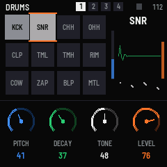 | 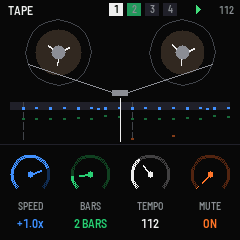 | 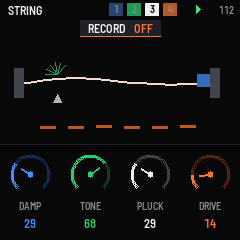 | 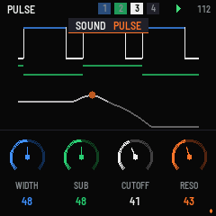 |
| 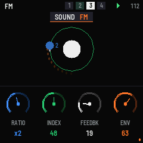 | 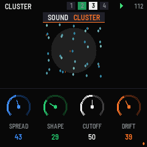 | 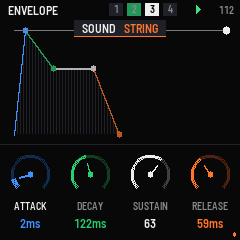 | 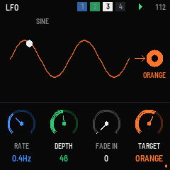 |
| 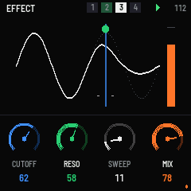 | 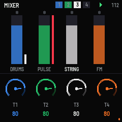 | 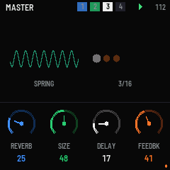 | 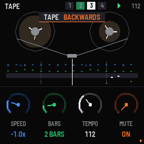 |

## UX 設計原則

1. **顏色就是對應關係**：K1 藍、K2 綠、K3 白、K4 橘。畫面底部是四顆同色的圓形旋鈕；上方圖形裡，每個可調的東西都畫成它那顆旋鈕的顏色。轉動時那顆旋鈕的環會變粗、標籤變亮，圖形中對應的元素從暗色變成全彩（`kcol()`，0.7 秒內）。不用讀文字就知道「這顆在調哪裡」。
2. **畫面就是聲音，不是參數表**：每種引擎都有自己的視覺隱喻，而且跟著聲音動（從 audio interrupt 讀 `VIEW`：每軌的電平、最新 voice 的包絡、LFO 相位、鼓墊命中次數、磁帶位置、捲盤角度）。
3. **一顆按鈕對應一個地方**：EDIT 音色、ENV 包絡、LFO、FX 效果、SEQ 磁帶、HOME 混音（再按一次是 master）。目前所在畫面的按鈕會亮。
4. **規則全部一致**：SELECT 永遠是「這個畫面的種類」（引擎、LFO 形狀、效果種類、小節數、delay 拍長）；PRESET / SEL 永遠是換軌；ALGORITHM 永遠是 tempo；K1–K4 永遠是畫面上那四個顏色的東西。
5. **提示不擋畫面**：提示是標題列下方的小膠囊，會往下滑入，約 1 秒後消失。
6. **按住 GLO = shift**：底部會換成 shift 說明，旋鈕也變成微調（混音頁則變成調聲相）。
7. **燈也是介面**：
   - 磁帶播放時：16 個白鍵的燈像跑馬燈一樣顯示循環的位置。
   - 鼓軌：被打到的鼓墊鍵會閃。
   - PLAY 燈：播放中亮。
   - REC 燈：準備錄音時亮，錄音中會閃。
   - ARP 燈：節拍器開著時亮。
   - SAVE 燈：有未存的變更時亮。
8. **開機就有東西可玩**：預設專案有一段 demo 磁帶（鼓和貝斯，T4 有兩顆鐘聲），T3 留空給你疊錄。
9. **動畫有節制**：LCD 是 SPI 傳輸，一整個畫面要幾十 ms，所以每幀只更新上半部 240×144。有東西在動時約 15 fps，閒置時約 4 fps（畫面仍會微微呼吸）；底部旋鈕只在數值變化時才重畫。

## 畫面

| 畫面 | 圖形 | K1 藍 | K2 綠 | K3 白 | K4 橘 |
|---|---|---|---|---|---|
| SOUND / STRING | 振動的弦：右端藍色阻尼毛氈、白色撥片、綠色火花、橘色熱度 | DAMP | TONE | PLUCK | DRIVE |
| SOUND / PULSE | 捲動的脈波（高電位段是藍色）、綠色 sub 方波、白色濾波器曲線、橘色共振點 | WIDTH | SUB | CUTOFF | RESO |
| SOUND / FM | 藍色調變行星繞白色載波星公轉（速度 = 頻率比）、綠色軌道（半徑 = index）、白色尾跡、橘色彗尾 | RATIO | INDEX | FEEDBK | ENV |
| SOUND / CLUSTER | 5 列粒子群（5 個去諧的鋸齒波）：藍色間距、綠色由圓變方、白色霧氣、橘色漂移 | SPREAD | SHAPE | CUTOFF | DRIFT |
| SOUND / DRUMS | 12 個鼓墊（4×3，被打到會亮會彈），右邊是選中鼓墊的圖：藍色音高柱、綠色衰減曲線、白色顆粒、橘色音量柱 | PITCH | DECAY | TONE | LEVEL |
| ENVELOPE | 四段四色的 ADSR，最新 voice 的即時電平是一條白線 | ATTACK | DECAY | SUSTAIN | RELEASE |
| LFO | 波形用「目標旋鈕」的顏色畫，白點跟著 LFO 跑；右邊是一顆目標顏色的小旋鈕 | RATE | DEPTH | FADE IN | TARGET（藍 / 綠 / 白 / 橘 / 音高 / 音量）|
| EFFECT | 乾訊號（灰）和處理後的波形（白），參數畫成彩色的牆、刻度、指示線、MIX 柱 | 依種類 | | | MIX |
| TAPE | 兩個轉動的捲盤（磁帶量從左盤轉到右盤）、磁頭（錄音時變紅）、4 軌事件在磁頭下捲動 | SPEED（−2× … +2×，負數就是倒轉）| BARS | TEMPO | MUTE |
| MIXER | 四條四色推桿（T1–T4 = K1–K4）加電平表；按住 GLO 調聲相 | T1 | T2 | T3 | T4 |
| MASTER | 彈簧線圈（REVERB / SIZE）、回聲圓點（DELAY / FEEDBK，會隨拍子跳動）| REVERB | SIZE | DELAY | FEEDBK |

LFO 的目標用「顏色」來選，這是 OP-1 很有趣的一點：選藍色，就是調變這個引擎的 K1。

## 按鈕

| 按鈕 | 作用 |
|---|---|
| EDIT / ENV / LFO / FX / SEQ / HOME | SOUND / ENVELOPE / LFO / EFFECT / TAPE / MIXER（HOME 再按一次 = MASTER）|
| PLAY | 播放 / 停止磁帶（停止時回到開頭）|
| REC | 準備錄音；播放中會把鍵盤彈的音錄到目前的軌（overdub）|
| GLO + PLAY | 磁帶反轉方向 |
| GLO + 按住 REC 0.7 秒 | 清除目前軌的磁帶 |
| SEL / PRESET 編碼器 | 換軌 T1 → T4 |
| SELECT 編碼器 | 這個畫面的種類 |
| ALGORITHM 編碼器 | tempo（40–240）|
| ARP | 節拍器 |
| SAVE | 存專案和磁帶（存在兩個物件裡）|
| OCT− / OCT+ | 八度（鼓軌不受影響：每個鍵固定是一個鼓墊）|

## 引擎（`app/engine.c`，在 FM-1 上從 RAM 執行，24.2 KB）
- **4 軌**，每軌是一種樂器，各自有包絡、LFO（指向某顆旋鈕、音高或音量）、效果（DRIVE / CRUSH / FILTER）、音量和聲相。
- **合成引擎**（8 voices，所有軌共用）：
  - STRING（Karplus-Strong：撥弦的激發先低通、再在撥弦位置做 comb）
  - PULSE（PolyBLEP 脈波 + sub + SVF 濾波）
  - FM（2-op，8 種頻率比，index 有自己的包絡）
  - CLUSTER（5 個去諧的鋸齒 / 方波，會漂移，兩級低通）
- **鼓**（6 voices，12 個鼓墊，每墊 4 個參數）：kick、snare、closed / open hat（closed 會切掉 open）、clap（3 次拍擊）、低 / 高 tom、rim、cowbell、zap、blip、metal。
- **Master**：乒乓 delay（跟 tempo 同步，1/8、3/16、1/4）、4 線 FDN「彈簧」reverb、節拍器、tanh 限幅。
- **磁帶**：每軌 192 個事件，96 PPQ，1 / 2 / 4 / 8 小節循環。速度 −2× 到 +2×：倒轉時 note-on 和 note-off 對調；磁帶上的音會跟著速度變調（12·log₂|speed| 半音），就像真的磁帶。錄音是 overdub，依 tick 排序插入。

## 編譯與實測（2026-11-06）
環境同 `../fm1-hello/README.md`。

```sh
./build.sh --host && app/build/host/toybox-4_host app/tests/basic.txt app/build/host
./build.sh --release 0.1 && ./build.sh --rfm1 --release 0.1
node base/tests/rfm1_test.mjs app/build/toybox-4-0.1.rfm1
```

- **host 模擬器**：`basic.txt` 全部 ok，涵蓋：
  - 鼓墊；demo 磁帶播放；在 T3 錄音並確認事件數
  - 4 種引擎和每個畫面的截圖
  - 磁帶倒轉、改 tempo、存檔重開後錄音還在、GLO+REC 清除
- **`demo.txt`**：錄了 25 秒，沒有削波。
- **`.fwsc`**：app 133 KB；`.app_ram` 24,232 B（`.ram_text` 共 29,196 / 32,768 B）；pool 282,772 / 344,064 B。fm1-base 的檢查全部 ok。
- **`.rfm1`**：191 KB。`rfm1_test.mjs` 和 FM1VST 的 `rfm1_check.py` 都 ok。
- **CPU**：host 上 demo 播放時 0.7 %、測試 1.2 %，比 PRISM-1 輕很多，FM-1 上應該沒問題（但還沒有實機數據）。

### 踩到的坑
- host 模擬器的 `reboot` 不會清空 RAM 裡的靜態變數，所以 `app_init` 要自己把 UI 狀態歸零（實機斷電本來就會清空）。
- app.c 裡叫 `P` 的巨集會跟 fm1-base 的 `host/rfm1.c` 撞名（只有編 `.rfm1` 時才會看到警告），改名成 `PJ`。
- RAM 程式碼裡的小 helper（`speed_now`、`lfo_wave`）如果沒有標成 inline 或 RAM，link 時會出現 "relocation truncated"。

## 沒做（OP-1 有的）
取樣（sampler / 錄外部聲音）、真正的音訊磁帶（現在是事件磁帶：FM-1 的 RAM 放不下 4 軌音訊）、各種 sequencer（endless、pattern、tombola…）、lift / drop / split 剪輯、每軌 EQ、COM 模式。
