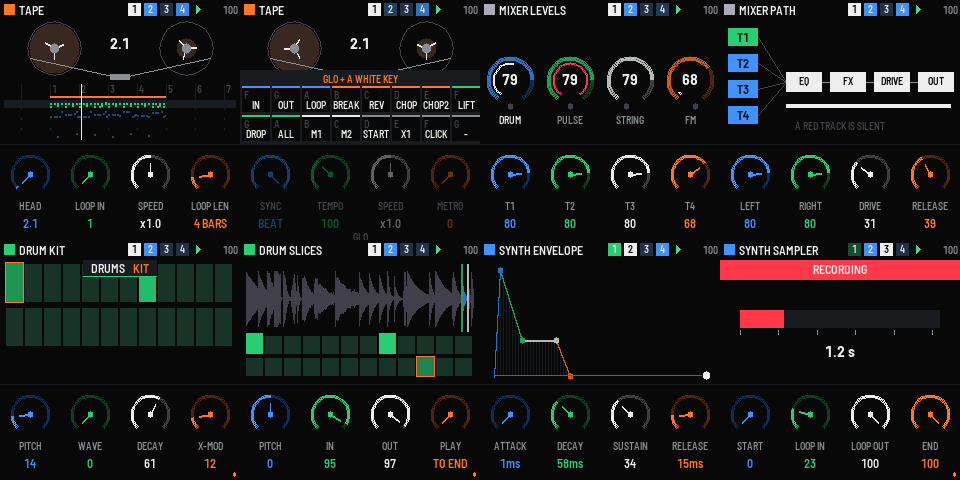
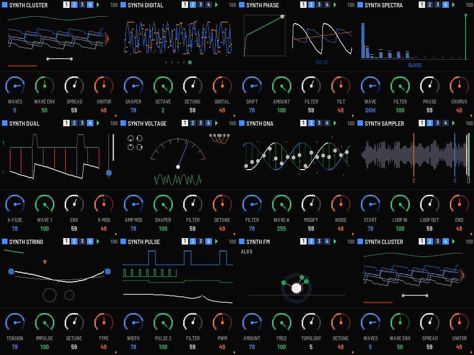
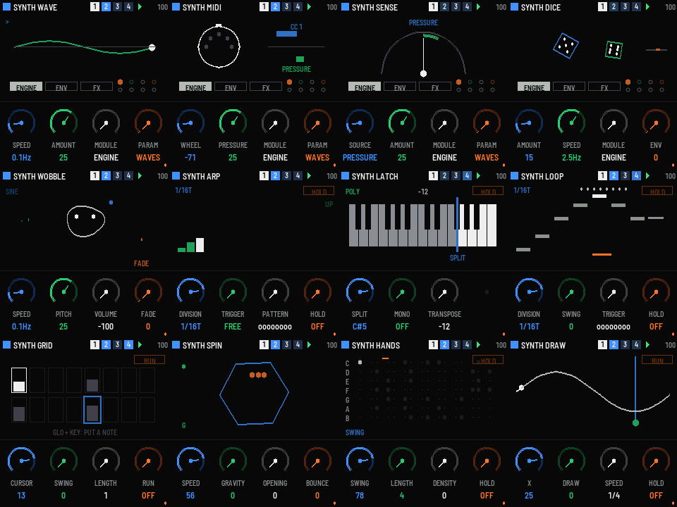

# TOYBOX-4 1.0：在 FM-1 上做 OP-1 式的口袋工作室

這是以 teenage engineering OP-1 的**系統架構與互動模式**為藍本的 M-VAVE FM-1 韌體。架構包括：
- 合成、鼓、磁帶、混音四種模式
- 每種聲音有 T1–T4 四個模組（引擎、包絡、效果、LFO），外加音序器
- 一卷 4 軌磁帶，有 tape tricks
- 一台把輸出取樣回去的 sampler

所有圖形、引擎、名稱、出廠聲音都是原創的。出廠聲音是程式合成的，沒有任何錄音。本專案沒有使用 OP-1 的外觀、圖示或商標，也與 teenage engineering、M-VAVE 無關。授權 MPL-2.0。

OP-1 的行為整理在 [`docs/OP1_REFERENCE.md`](docs/OP1_REFERENCE.md)，這次的設計就是以它為準。

- `dist/toybox-4-1.1.fwsc`：燒進 FM-1 實機
- `dist/toybox-4-1.1.rfm1`：在 RemoteFM1 裡跑
- `dist/toybox-4-demo.mp3`：demo，約 58 秒。流程是：
  1. 開機自帶的 demo 磁帶播放
  2. 在 T3 疊錄一段旋律
  3. 把 T3 的引擎從 STRING 換成 FM，磁帶上的音符不動、音色跟著變
  4. tape break 讓磁帶煞停
  5. 倒轉、再轉回



## 這一版有什麼（相對 0.1）

| | 0.1 | 1.0 |
|---|---|---|
| 軌 / 樂器 | 4 軌，每軌一種 | 4 軌 × 每軌**同時有合成和鼓兩種樂器**（OP-1：一軌錄什麼由當下的模式決定）|
| 合成引擎 | 4 | **11**：STRING PULSE FM CLUSTER DIGITAL PHASE SPECTRA DUAL VOLTAGE DNA SAMPLER |
| 鼓 | 12 個合成鼓墊 | **KIT**（24 鍵，每鍵 8 參數的合成鼓）／ **SLICES**（取樣切 24 片，出廠 24 種合成打擊樂）|
| 效果 | 3 | 每個聲音一個，**9 種**：ECHO CUBE TURBO WIRE KNOCK COIL DOPPLER HALL BITS |
| LFO | 1 種 | **5 種**：SENSE DICE WOBBLE WAVE MIDI，可指向任一模組的任一參數 |
| 音序器 | 無 | **7 種**：LOOP GRID SPIN HANDS DRAW ARP LATCH |
| 磁帶 | 每軌 192 事件，最多 8 小節 | 每軌 960 事件、**128 小節**、varispeed 0.25–2×、倒轉、**16 種 tape tricks**（loop in/out、break、chop、lift/drop、memo…）|
| 混音 | 4 推桿 + master | 推桿 / 聲相 / 靜音、**3 段 EQ**、**master FX**（9 種任選）、**輸出級**（drive 壓縮限幅、左右音量）、訊號路徑圖 |
| Sampler | 無 | 按住鍵把 master 輸出**錄進快閃**（合成 5.2 s、鼓 8.3 s），變成 SAMPLER 引擎或 SLICES 鼓組的素材 |
| 音色庫 | 無 | 合成 8 個 + 鼓 8 個 slot，可存可還原；專案和磁帶存在快閃 |
| 雙核心 | 否 | voices 分給兩顆 CPU 算（cpu2 失敗時自動回到單核）|

## 架構

```
          ┌──────────── 主迴圈（UI、畫面、快閃）─────────────┐
 keys ──► │ input() → proj_t（整個專案）──core_project()──►  │  雙緩衝：render 每個 block 換一次索引
 knobs    │          core_key/… ──► 指令環（64）──────────►  │
          │ app_frame：上半部 240×144 動畫（≈30 fps）、下半部旋鈕（有變化才畫）│
          └──────────────────────────────────────────────────┘
                              │ CORE_VIEW（電平、包絡、LFO、步數、球…）◄── 唯讀
 audio IRQ ─► core_render（RAM 程式碼）每 64 frame：
   磁帶移動 → 音序器 → 節拍器 → 8 個 instance（4 軌 × 合成/鼓）的 LFO 與參數
   → voices：合成 8 + 鼓 8，偶數在 core 0、奇數在 core 1（plat_cpu2_run）
   → 每個 instance 的 FX（arena 6 K × int16）→ 音量、聲相
   → EQ → master FX（arena 32 K）→ 輸出級 → sampler 取樣環（µ-law，22 kHz）
```

- `app/dsp/`：聲音核心（`core.c`、`core_tape.inc`、`core_seq.inc`）、引擎（`eng_synth.c`、`eng_drum.c`）、效果（`fx.c`）、混音（`master.c`）。音訊路徑全部放在 RAM 執行。
- `app/app.c`：專案、音色庫、快閃存檔、sampler 的寫入狀態機。
- `app/ui_*.inc`：
  - `ui_base`：顏色和繪圖小工具
  - `ui_pics`：32 張模組動畫圖
  - `ui_draw`：其他畫面
  - `ui_screens`：按鍵對應與旋鈕表

## 互動（跟 OP-1 一樣的規則）

| 按鈕 | 作用 |
|---|---|
| EDIT | 合成模式（目前軌用合成樂器）；GLO+EDIT 還原這個 slot |
| ARP | 鼓模式（目前軌用鼓樂器）；GLO+ARP 還原 |
| HOME | 磁帶 ↔ 混音；在混音時 GLO+HOME 看訊號路徑，其他時候 GLO+HOME 是 USB host（接 USB MIDI 鍵盤）|
| SEL / ENV / FX / LFO | **T1–T4**。合成/鼓：引擎、包絡、效果、LFO（FX、LFO 再按一次開關）。磁帶：選軌（GLO = 靜音）。混音：音量、EQ、master FX、輸出 |
| SEQ | 音序器頁；在音序器頁再按一次（或 GLO+SEQ）開關 |
| PLAY | 播放 / 停止；GLO+PLAY 倒轉 |
| REC | 準備錄音（錄到目前軌，overdub）；在 SAMPLER / SLICES 的引擎頁是 sampler；GLO+按住 REC 清除這軌 |
| OCT− / OCT+ | 八度；磁帶頁是前後一小節（GLO：頭 / 尾）；音序器頁 GLO+OCT 是休止 / 刪除 |
| SAVE | 點一下存專案；按住是說明；GLO+SAVE 把目前聲音存進 slot |
| PRESET 編碼器 | 合成/鼓：換 slot（8 個）；其他模式：換軌 |
| ALGO 編碼器 | tempo（40–220）；GLO：節拍器音量 |
| SELECT 編碼器 | 這一頁的「種類」：引擎、效果、LFO、音序器、master FX；磁帶頁是捲帶（GLO：一次一小節）|
| K1–K4 | 藍、綠、白、橘；GLO 按住時是第二排參數（也用來微調）。旋鈕有加速度，快轉時約一圈走完全程 |

**顏色就是對應關係**：每張圖裡，K1–K4 動到的東西就畫成那顆旋鈕的顏色。剛轉過的 0.7 秒內會變亮；GLO 那一排的東西平常是暗色，按住 GLO 才亮。

**磁帶的 tape tricks**：在磁帶頁按住 GLO，再按白鍵：

| 鍵 | F | G | A | B | C | D | E | F |
|---|---|---|---|---|---|---|---|---|
| 第 1 排 | LOOP IN | LOOP OUT | LOOP 開關 | BREAK（按住：減速到停）| REVERSE | CHOP（按住：重複這一拍）| CHOP ½ 拍 | LIFT（剪下循環或這小節）|

| 鍵 | G | A | B | C | D | E | F | G |
|---|---|---|---|---|---|---|---|---|
| 第 2 排 | DROP（貼上）| LIFT 全部軌 | MEMO 1 | MEMO 2（按住 0.6 秒存速度、方向、混音；點一下叫回）| 回到開頭 | 速度歸 1× | 節拍器 | – |

磁帶的 K1–K4 是：磁頭位置、循環起點、速度（varispeed）、循環長度。GLO 那排是：sync（速度要不要拖著 tempo 走）、tempo、固定速度、節拍器。

## 接 USB MIDI 鍵盤（USB host）

**GLO + HOME**（混音模式以外；混音模式裡仍是訊號路徑）：把 FM-1 的 USB-C 切成 **host**，接上 USB MIDI 鍵盤或控制器就能直接彈；再按一次，USB 就交還給電腦。開機時一定是一般的裝置模式。

- **要外接電源**：FM-1 不從 USB-C 供 5V 電。要用以下其中一種：
  - 有外接電源的 USB hub：FM-1 接 hub 的上游，鍵盤插下游。
  - 可另外插充電器的 OTG 轉接頭。
- **支援的裝置**：class-compliant 的 USB MIDI 1.0（full speed）鍵盤或控制器，可以直接接，或經過一個 hub。不支援低速裝置、多層 hub、MIDI 2.0 和 SysEx。
- **畫面**：
  - 提示列會顯示：等待中、鍵盤自己的名稱加「CONNECTED」、「NOT MIDI」，或「UNPLUGGED」。
  - 標題列右上角（取代 tempo）出現 USB 標示：暗色是等待中，亮色是已連上。
- **能彈什麼**：鍵盤送來的音符、力度、滾輪、pitch bend、sustain 等，跟原本的 MIDI 輸入一樣處理。彈的是目前這一軌，錄音時也會錄進磁帶。
- **拔掉時**：自動放開所有音，不會卡音。
- **當 host 的期間**：沒有電腦連線，USB 音訊、韌體更新、螢幕鏡像都暫停。
- **底層**：felucca-bsp 的 USB MIDI host，從 Melodee 韌體移植，`fm1.toml` 的 `usb_host = true`。
- **測試狀態**：
  - 只在 host 模擬器上測過插上、彈奏、拔掉，測試檔是 `app/tests/usbh.txt`。
  - 這份移植版本身，文件寫明還沒有實機驗證。
  - 能不能認到 hub，也取決於 FM-1 的 USB-C CC 接法和你用的轉接頭。

## 模組



| 引擎 | 圖 | K1 | K2 | K3 | K4 | GLO：K1 | K2 | K3 | K4 |
|---|---|---|---|---|---|---|---|---|---|
| STRING | 撥動的雙弦、弦鈕、撥片或弓、共鳴箱 | TENSION | IMPULSE | DETUNE | TYPE | PLUCK | BRIGHT | BODY | DRIVE |
| PULSE | 兩列脈波、sub、濾波器曲線 | WIDTH | PULSE 2 | FILTER | PWM | RESO | SUB | F.ENV | DRIVE |
| FM | 4 個算子當行星，依演算法互相公轉 | AMOUNT | FREQ | TOPOLOGY | DETUNE | FEEDBK | OP 3/4 | DECAY | BRIGHT |
| CLUSTER | 1–6 條去諧波形，被 unitor 收攏 | WAVES | WAVE ENV | SPREAD | UNITOR | SHAPE | DRIFT | FILTER | SUB |
| DIGITAL | 平滑波 vs 取樣保持 + 位元階梯 | SHAPER | OCTAVE | DETUNE | DIGITAL | BITS | WAVE | NOISE | FOLD |
| PHASE | 左邊相位彎曲曲線，右邊輸出波 | SHIFT | AMOUNT | FILTER | TILT | WAVE | DIST ENV | SUB | DETUNE |
| SPECTRA | 24 條泛音柱、頻譜濾波線、chorus | WAVE | FILTER | PHASE | CHORUS | ODD/EVEN | HARMONICS | TILT | MOTION |
| DUAL | 兩個振盪器、交叉淡入滑桿、cross-mod 細線 | X-FADE | WAVE 1 | ENV | X-MOD | INTERVAL | WAVE 2 | DETUNE 2 | CUTOFF |
| VOLTAGE | 類比錶頭、phaser、folder、跳線 | AMP MOD | SHAPER | FILTER | DETUNE | GROUND | SUB | DRIFT | BIAS |
| DNA | 旋轉的雙螺旋，每階是波形的一個點 | FILTER | WAVE # | MODIFY | NOISE | WALK | STEPS | RESO | OCTAVE |
| SAMPLER | 真正的取樣波形和 4 個標記 | START | LOOP IN | LOOP OUT | END | REVERSE | IN FINE | OUT FINE | GAIN |


| 效果 | 圖 | K1 | K2 | K3 | K4 |
|---|---|---|---|---|---|
| ECHO | 漸遠漸淡的回聲圓 | TIME | SPEED | FEEDBK | MIX |
| CUBE | 線框立方體，x / y / z 邊各是一顆旋鈕的顏色 | X SIZE | Y SIZE | Z FEEDBK | MIX |
| TURBO | 雙共振峰濾波曲線 | FREQ | FOLLOW | RESO | FREQ 2 |
| WIRE | 兩個罐頭電話，訊號封包、斷線 | TONE | PHONIC | BAUD | TELEMATIC |
| KNOCK | 壓縮曲線 + 一記敲擊的包絡 | FREQ | PUNCH | ROUNDS | POWER |
| COIL | 振動的彈簧 | TONE | TURNS | DAMPING | MIX |
| DOPPLER | 來回移動的喇叭和被擠壓的波前 | FREQ | DELAY | FEEDBK | SIDEBAND |
| HALL | 透視的房間，聲音粒子撞牆回來 | DISTANCE | GATE | COLOR | MIX |
| BITS | 取樣保持與量化的像素階梯 | RATE | BITS | MODEL | MIX |



- **LFO**：
  - SENSE：壓力、速度、包絡、電平或滾輪 → 任一參數
  - DICE：隨機漫遊整個模組
  - WOBBLE：音高加音量的果凍
  - WAVE：5 種波形，可同步拍子
  - MIDI：滾輪和壓力
- **音序器**：
  - LOOP：步進輸入，有休止和延音
  - GRID：16 格
  - SPIN：在旋轉的六角形裡丟球，球撞牆就發音；開口在第 4 面牆
  - HANDS：每個白鍵一種 pattern
  - DRAW：用綠色旋鈕畫 32 點的曲線
  - ARP：4 種走法、1–4 個八度、觸發 pattern
  - LATCH：分鍵點、單音或複音、移調

## 預算（實測，`./build.sh --release 1.1`）

| | 用量 | 上限 |
|---|---|---|
| 韌體映像 | 566 KB（其中出廠取樣 308 KB）| 581.5 KB |
| SRAM | 485.0 KB：RAM 程式碼 104 KB、.data+.bss 80 KB、pool 301 KB（磁帶 30 KB、voices 的延遲線、FX arena 8×12 KB + 64 KB）| 495.1 KB（剩 10 KB，build 規定至少留 8 KB）|
| 主 / 中斷堆疊 | 最壞 1.5 KB / 2.8 KB（靜態分析）| 8 KB / 4 KB |
| 快閃資料區 | 合成取樣 112 KB、鼓取樣 180 KB、專案 + 音色庫 92 KB | 全部用上 |
| CPU | host 模擬器上 1.5 %；引擎每 sample 約 15–130 flops | 2 × 360 MHz |

減法做在哪裡：
- 磁帶事件 1024 → 960
- 取樣環 8 K → 4 K
- 剪貼簿 1024 → 512
- 指令環 128 → 64
- 主堆疊和中斷堆疊合計少 20 KB（改用靜態分析確認的大小）
- 專案從「工作副本 + 雙緩衝」改成只換索引的雙緩衝
- 出廠鼓取樣縮短 CRASH、BELL、SUB 的尾音，每個聲音加 20 ms 淡出

這樣快閃從超出 1.3 KB 變成剩 15 KB，SRAM 從超出 23.7 KB 變成剩 10 KB。

## 編譯與測試

環境同 `../fm1-hello/README.md`。

```sh
./build.sh --host && app/build/host/toybox-4_host app/tests/basic.txt app/build/host   # 冒煙測試，全部 ok
app/build/host/toybox-4_host app/tests/demo.txt app/build/host                        # demo.wav
./build.sh --release 1.1 && ./build.sh --rfm1 --release 1.1
node base/tests/rfm1_test.mjs app/build/toybox-4-1.1.rfm1
```

`basic.txt` 涵蓋：
- 磁帶播放
- 混音四頁和訊號路徑
- 11 種引擎、鼓組 / 切片
- 錄到 T3
- ARP 和 SPIN（確認球數）
- sampler 全流程（錄 1.1 秒）
- 說明頁
- 存檔後重開

引擎另外在桌機的 harness 上測過：預設和隨機參數下沒有 NaN；每顆旋鈕都會改變聲音；重觸發不爆音；每個鼓聲都會結束。

## 已知限制 / 還沒做的

- 磁帶記錄的是**事件**，不是音訊：FM-1 的 RAM 放不下 4 軌音訊。所以換音色時，磁帶上的樂句會用新音色重播。這算一個特色，但跟 OP-1 不同。
- 沒有 COM 模式、沒有 OP-1 的 album / 錄音碟。
- 引擎的音色只用數值調過，還沒有人在實機上用耳朵聽過；實機上的 CPU 用量也還沒量。
- PHASE、CLUSTER 在極端設定下峰值約 1.2，由輸出級的 soft clip 擋住。
